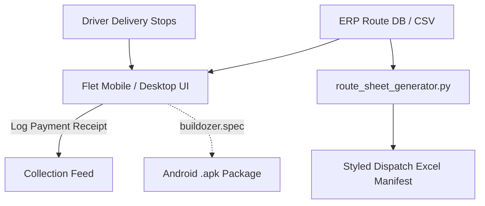

# 📱 Route POS Merchant & Collection App

[-02569B?style=for-the-badge&logo=flutter&logoColor=white)](https://flet.dev)
[](https://flet.dev)
[](https://opensource.org/licenses/MIT)

A cross-platform Mobile & Desktop Point-of-Sale (POS) application built with **Flet (Python wrapper for Flutter)**, featuring Android compilation via Buildozer and an automated styled route dispatch Excel generator.

---

## 🌟 Features

- **Flutter-Powered Modern UI**: Smooth 60fps animations, dark mode aesthetics, and touch-optimized controls running on Windows, macOS, Linux, and Android.
- **Route Stop Sequence Selector**: Selects customer delivery stops dynamically from ERP route databases or offline datasets.
- **Collection Receipt Tracking**: Fast logging of cash, digital UPI, or returns credit directly on the delivery route.
- **Automated Dispatch Excel Sheet**: `route_sheet_generator.py` produces styled, formatted driver manifests with custom borders, headers, and column autofitting via `openpyxl`.
- **Android APK Ready**: Preconfigured with `buildozer.spec` for 1-click mobile APK compilation.

---

## 🚀 Quickstart

### 1. Installation
```bash
pip install -r requirements.txt
```

### 2. Run Desktop App
```bash
python app/main.py
```

### 3. Generate Styled Route Dispatch Sheet
```bash
python services/route_sheet_generator.py
```

### 4. Build Android APK (Linux / WSL)
```bash
pip install buildozer
buildozer android debug
```
The compiled APK will be output to `./bin/`.

---

## 🏗️ Architecture



---

## 👨‍💻 Author
**Jose Anoob** — [GitHub Profile (@N0-DE)](https://github.com/N0-DE)
